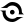
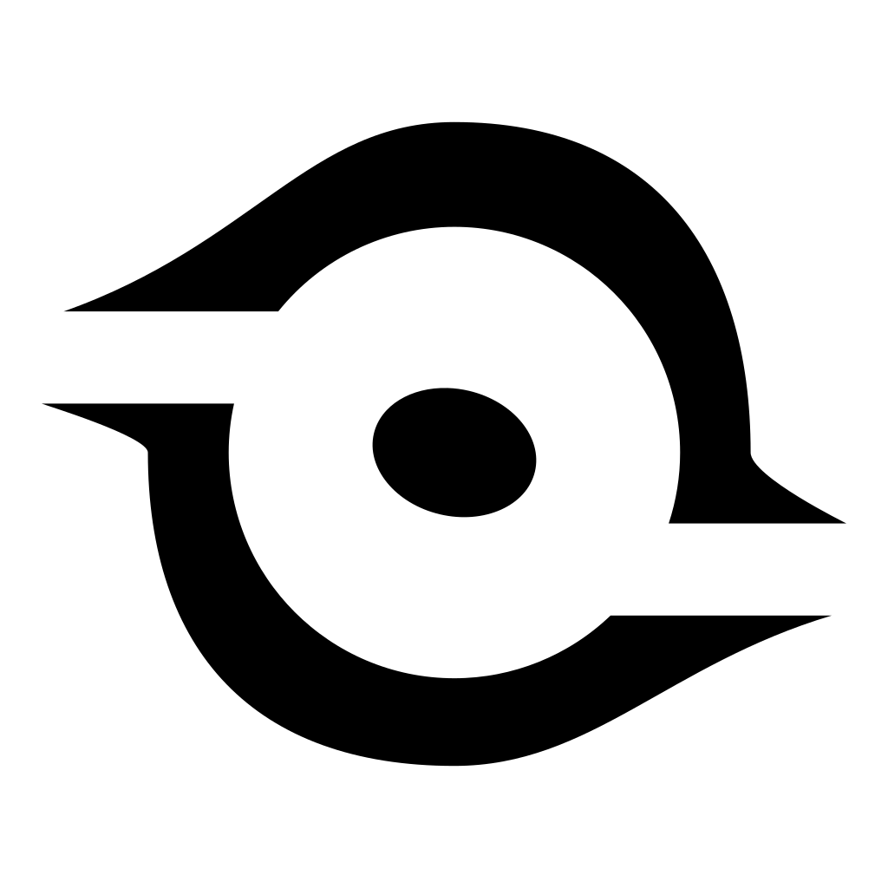
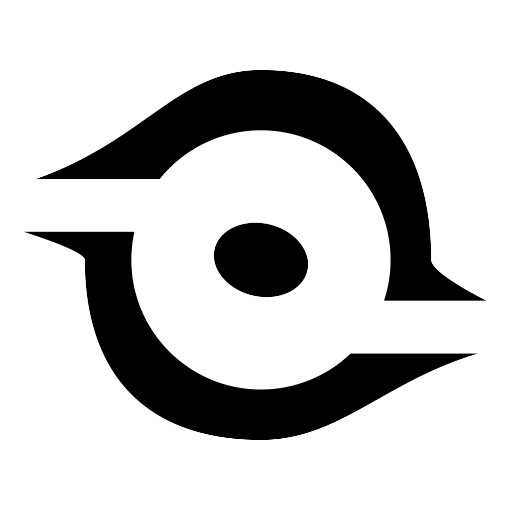
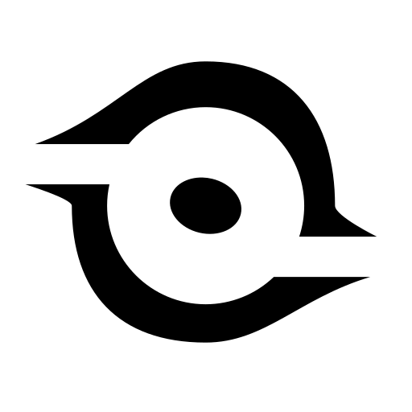
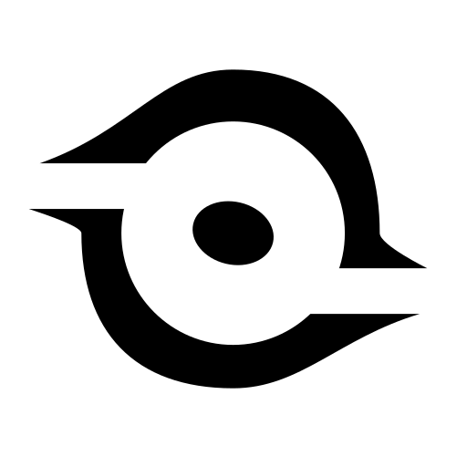
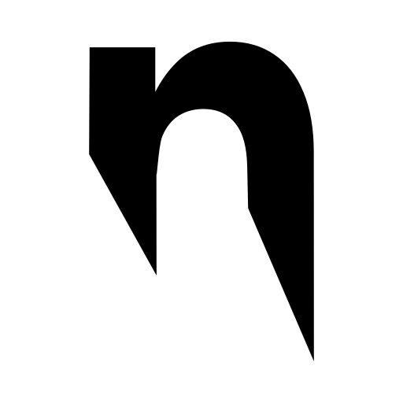
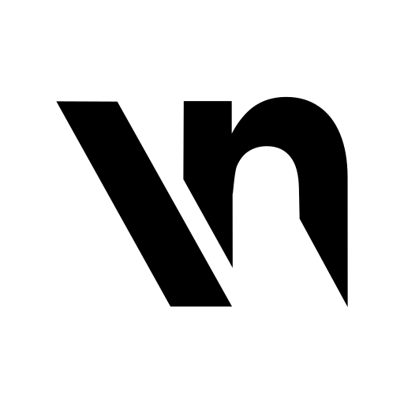
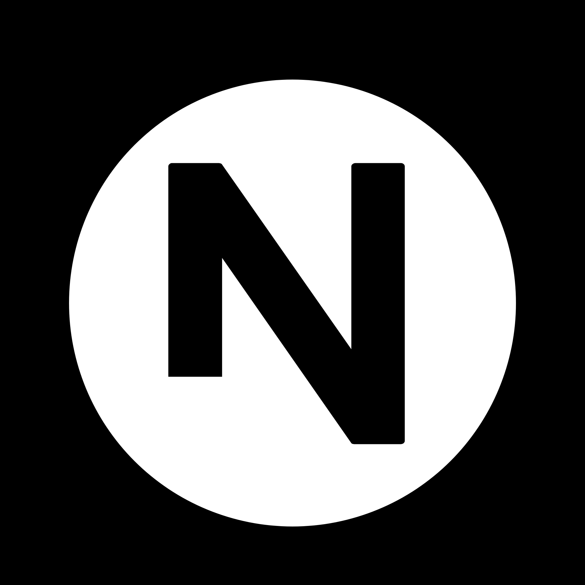

# Nanoo Logo History

## Overview

The Nanoo logo represents the visual identity of Nanoo. It has evolved from a simple mobile design into a clean, professional vector mark used in modern web projects.

## Naming

**Nanoo** [/ˈnæ.nuː/](https://ipa-reader.com/?text=%CB%88n%C3%A6.nu%CB%90) (pronounced **nah-noo**). Two syllables, primary stress on first. End in a long "oo" (as in "goose"), not a short "u" (as in "nut"). The IPA `nuː` marks that long vowel; a common misreading is "na-nu", but correct sound is "nah-noo".

## Visual Gallery

Preview follow your viewer color scheme. Theme aware versions (v2.1.1+) adapt on their own; archive dual-file versions switch via `<picture>`.

| Version                 | Preview                                                                                                                                                                          |
| :---------------------- | :------------------------------------------------------------------------------------------------------------------------------------------------------------------------------- |
| **v2.1.3**              |                                                                                                                  |
| **v2.1.2** _(Archived)_ |                                                                                                                  |
| **v2.1.1** _(Archived)_ |                                                                                                                  |
| **v2.1.0** _(Archived)_ | <picture><source media="(prefers-color-scheme: dark)" srcset="./logomark/v2.1.0/nanoo-dark.svg"></picture> |
| **v2.0.0** _(Archived)_ | <picture><source media="(prefers-color-scheme: dark)" srcset="./logomark/v2.0.0/nanoo-dark.svg"></picture> |
| **v1.5.0** _(Archived)_ | <picture><source media="(prefers-color-scheme: dark)" srcset="./logomark/v1.5.0/nanoo-dark.svg"></picture> |
| **v1.4.2** _(Archived)_ | <picture><source media="(prefers-color-scheme: dark)" srcset="./logomark/v1.4.2/nanoo-dark.svg"></picture> |
| **v1.2.0** _(Archived)_ | <picture><source media="(prefers-color-scheme: dark)" srcset="./logomark/v1.2.0/nanoo-dark.svg"></picture> |
| **v0.0.1** _(Archived)_ | <picture><source media="(prefers-color-scheme: dark)" srcset="./logomark/v0.0.1/nanoo-dark.svg"></picture> |

## Brand Evolution

The logo started as a draft created in PixelLab. Later, we moved the design to Inkscape to create a high-quality vector file. This change ensures that the logo looks sharp at any size.

We also updated the typography over time, moving from early fonts to the current **Geist** font to match a modern and simple aesthetic.

## Changelog

| Version    | Date          | Description                                                                                                                                                                                                                                         |
| :--------- | :------------ | :-------------------------------------------------------------------------------------------------------------------------------------------------------------------------------------------------------------------------------------------------- |
| **v2.1.3** | Oct 09, 2026  | Relative to v2.1.2: removed rounded background rect, shrunk canvas `viewBox 1024` to `24` (no more fix `width`/`height`), fill `#000` to `currentColor`, merged path split to 3 (orbit + core), dark mode via `color-scheme:dark`. 1290 B to 927 B. |
| **v2.1.2** | July 21, 2026 | **[Archived]** Added rounded background rect (`rx="55"`) for favicon visibility.                                                                                                                                                                    |
| **v2.1.1** | July 08, 2026 | **[Archived]** Merged light/dark variants into one theme-aware SVG via `prefers-color-scheme`. Single file for favicon & universal use.                                                                                                             |
| **v2.1.0** | June 28, 2026 | **[Archived]** Optimized geometry using Boolean difference (`Ctrl` + `-`) to a true single path transparent vector cut out.                                                                                                                         |
| **v2.0.0** | June 27, 2026 | **[Archived]** Revamp Nanoo Logo. Inspired by a black hole to represent the letter "O/o".                                                                                                                                                           |
| **v1.5.0** | May 20, 2026  | **[Archived]** Switched font to **Geist**. Final path optimization.                                                                                                                                                                                 |
| **v1.4.2** | May 18, 2026  | **[Archived]** Minor path adjustments and metadata cleanup.                                                                                                                                                                                         |
| **v1.2.0** | May 08, 2026  | **[Archived]** First pure vector version using **Adwaita Sans** font (Moved to Inkscape).                                                                                                                                                           |
| **v0.0.1** | Mar 08, 2026  | **[Archived]** Initial draft. Converted from PixelLab (PNG) to Inkscape SVG.                                                                                                                                                                        |

---

**Author:** Adnan Slamet Wibowo (nanoolabs)
**Official URL:** [nanoolabs.dev](https://nanoolabs.dev)
